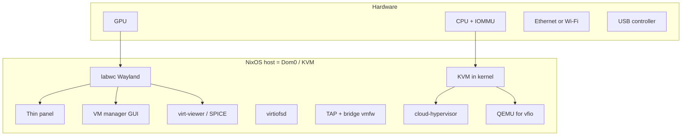
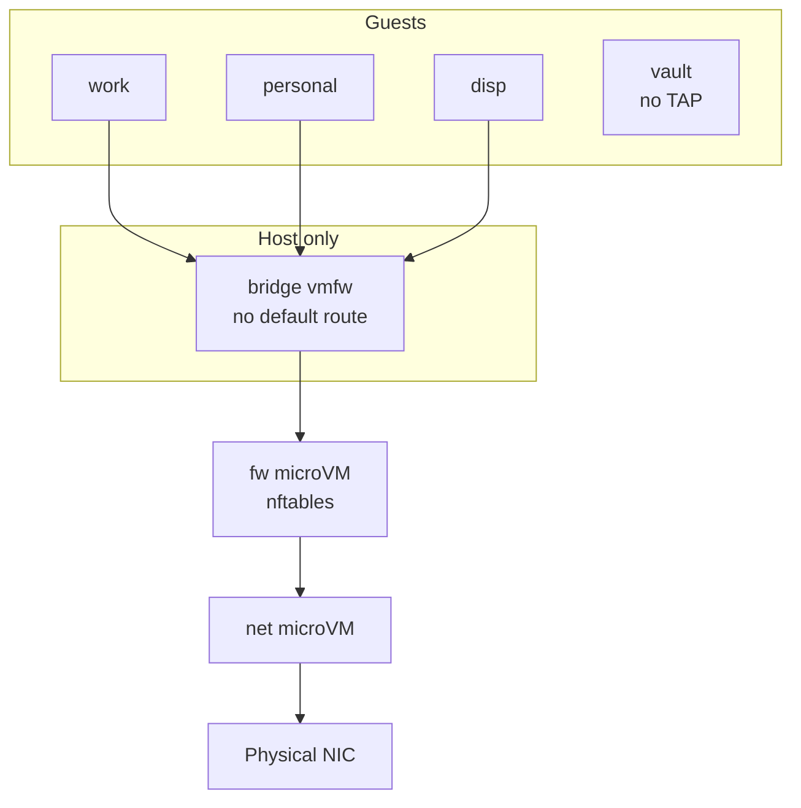
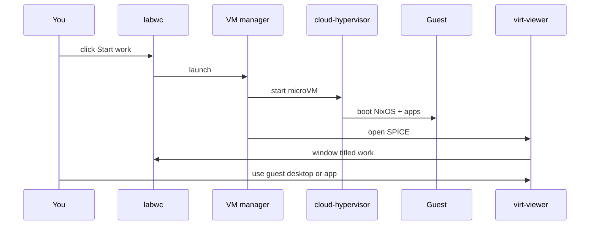
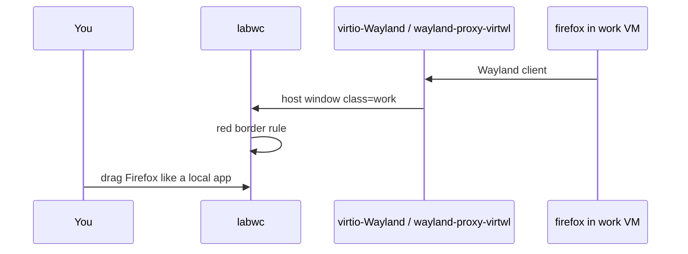
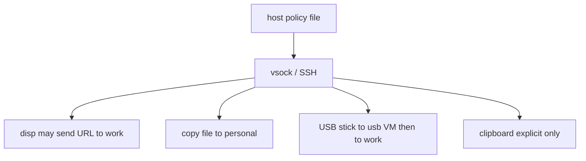

# Flow plan

How the system is supposed to connect. Pair with [[Nixos Qubes Setup]] and [[Milestones]].

Obsidian: mermaid diagrams render in preview.

---

## 1. What you sit in



Host has no browser. Mouse and windows live in **labwc**. The manager starts VMs. Groundwork: viewer windows. Later: guest apps appear as labwc windows (same compositor, no extra viewer).

---

## 2. A guest is a list, not a cloned disk

```mermaid
flowchart LR
  base[base.nix<br/>kernel login virtio overlay]
  graph[preset: graphical]
  netp[preset: networked]
  apps[package list]

  base --> VM
  graph --> VM
  netp --> VM
  apps --> VM

  VM[one microVM]
```

Examples:

```
browser  = base + graphical + networked + [ firefox ]
dev      = base + graphical + networked + [ editor git ]
vault    = base + graphical + [ keepassxc ]     # no TAP
disp     = base + graphical + networked + [ firefox ]  # no /home disk
work     = base + graphical + networked + [ firefox libreoffice ]
```

`minimal` is the only template. There is no workstation image. Each AppVM is `minimal` plus its own package list. A disposable has no `/home` disk.

---

## 3. Traffic (security)



Nothing on `vmfw` talks to the internet except through **fw → net**. Host has no uplink. vault is offline.

Later vfio: NIC lives in `net` (QEMU), not the host.

---

## 4. How a window appears (two eras)

### Era A — groundwork (must work first)



You see **one window per VM**. Inside: XFCE or a single app. This is not Qubes-seamless. It is usable.

### Era B — seamless (the aim)



Firefox is a **labwc window**. No SPICE box. Color = VM. This is the Qubes-like UI. Experimental. Era A stays as fallback.

---

## 5. Start / stop / update

```mermaid
flowchart LR
  flake[flake.nix]
  rebuild[nixos-rebuild on host]
  store[/nix/store shared virtiofs]
  systemd[microvm@.service]
  guest[guest boots new closure]

  flake --> rebuild
  rebuild --> store
  rebuild --> systemd
  systemd --> guest
```

Nix defines the VMs. Salt in `salt/` starts them. Rebuild the host, then reboot the guest, to change what the guest contains.

---

## 6. Trust / policy (later)



Nothing automatic between VMs.

---

## 7. Repo / flake layout (target)

```
flake.nix
hardware-configuration.nix    # generated on the install machine
modules/
  host.nix                    # KVM, labwc, autologin, bridges, virtiofsd
  base.nix                    # every guest
  presets/
    graphical.nix
    networked.nix
  vms/
    net.nix
    fw.nix
    work.nix                  # packages = [ firefox ... ]
    personal.nix
    disp.nix
    vault.nix
  gui/
    manager.nix               # VM manager package
scripts/                      # VM manager
salt/                         # start sys-net, personal, work
```

---

## 8. What is in / out of the host

**On the host**

- kernel, KVM, labwc, panel, VM manager, virt-viewer, virtiofsd, TAP/bridge, SSH (optional)

**In VMs**

- browsers, editors, mail, XFCE if wanted, USB, “real” internet

**Never on the host**

- Firefox, Chromium, Flatpak, GNOME, IceWM as the session
